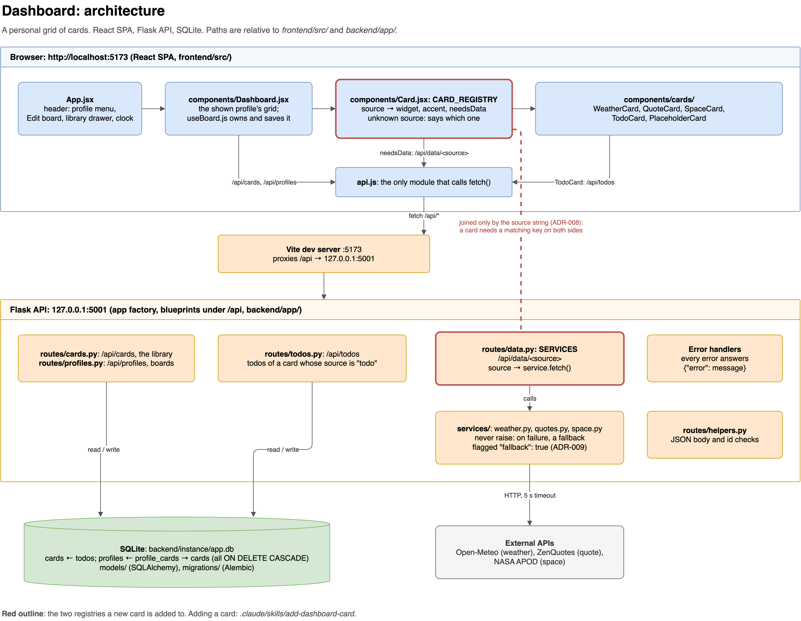

# Dashboard

A personal dashboard of cards: a React frontend over a Flask API, with SQLite. Some cards show live data from public APIs (weather, a quote, NASA's photo of the day), one keeps its own data (todos), and new cards slot in through a small registry on each side.



## Prerequisites

- **Python 3.11+.** The backend uses `datetime.UTC`, added in 3.11. A bare `python3` on macOS is often the system 3.9 or a conda `base` 3.10, which fails only later, at `db upgrade`, so build the venv with an explicit interpreter (below).
- **Node.js 22**, pinned in `frontend/.nvmrc`. Use [nvm](https://github.com/nvm-sh/nvm) to match it.
- **[uv](https://github.com/astral-sh/uv)**, only for the random-tools MCP server, not for running the app.
- **[jq](https://jqlang.org)**, needed by the repo's Claude Code hooks: the safety hook blocks every shell command when `jq` is missing. macOS 15 and later include it; earlier macOS: `brew install jq`; Windows: `winget install jqlang.jq`.
- **Windows: Git Bash.** The hooks and the status line in `.claude/` are bash scripts. Claude Code on native Windows runs them through Git Bash when it is installed ([Git for Windows](https://git-scm.com/downloads/win)); without it they run in PowerShell, fail, and the safety hook can block tool calls.

## Environment variables

Copy `.env.example` to `.env` in the project root (`cp .env.example .env`). Both values are optional:

- **`NASA_API_KEY`**: free at [api.nasa.gov](https://api.nasa.gov/). Without it the space card uses NASA's shared `DEMO_KEY`, which is heavily rate limited.
- **`FLASK_SECRET_KEY`**: `backend/config.py` falls back to a development value.

Weather comes from Open-Meteo and quotes from ZenQuotes; neither needs a key. When an external API fails, its card shows a marked fallback instead of an error (ADR-009).

## Setup

### Backend

```bash
cd backend
python3.11 -m venv venv        # or any 3.11+ interpreter, named explicitly
source venv/bin/activate       # Windows (Git Bash): source venv/Scripts/activate
pip install -r requirements-dev.txt   # the app's dependencies plus the test and lint tools
flask --app run.py db upgrade
python seed.py
python run.py                  # http://127.0.0.1:5001
```

`python seed.py` only adds the default cards that are missing, so it is safe to re-run. `python seed.py --reset` wipes all cards, profiles and todos and restores the default board and the "Default" profile (ADR-017, ADR-019).

### Frontend

```bash
cd frontend
nvm use                        # Node 22; `nvm install` the first time
npm install                    # installs exactly what package-lock.json pins
npm run dev                    # http://localhost:5173, proxies /api to the backend
```

One dependency is held back on purpose, an exception to ADR-012's latest versions: `satellite.js` stays on 6.x (the ISS card's orbit maths). Version 7 adds WebAssembly builds that `vite build` cannot bundle.

## Checks

Every suite runs offline. The backend and frontend tests fail on any request they did not mock; the end-to-end suite answers the external data APIs in the browser.

| What | Where | Command |
|---|---|---|
| Backend tests (pytest, in-memory database) | `backend/`, venv active | `pytest` |
| Backend lint (Ruff) | `backend/`, venv active | `ruff check .` |
| Type check (Pyright, the backend) | repo root, venv active | `pyright` |
| Frontend tests (vitest) | `frontend/` | `npm run test:run` |
| Frontend formatting (Prettier) | `frontend/` | `npm run lint` |
| End-to-end (Playwright) | `frontend/` | `npm run test:e2e` |
| UI check (layout at several widths) | repo root, app running | `node .claude/skills/check-ui/scripts/check-ui.mjs` |

- **The frontend needs Node 22.** On an older Node the suite stops with a message instead of reporting zero tests.
- **The end-to-end suite** runs the real app on its own ports (5011 and 5183) against a throwaway database (`backend/instance/e2e.db`), so it never touches your dev servers or your data. It needs the backend venv, and Chromium once: `npx playwright install chromium`.
- **The UI check** is the `check-ui` skill's script: every page state in `frontend/e2e/ui-states.js` at several widths, reported as text (sideways overflow, element positions), accessibility trees and one contact-sheet image in `frontend/test-results/check-ui/`. It reads from the running app and refuses every write, so your data is safe.
- Why the suites exist and what they are held to: [ADR-016](docs/adr/ADR-016-test-seam-for-agentic-workflows.md) and [`docs/coding_standards.md`](docs/coding_standards.md).

## Project structure

```
backend/
  app/
    __init__.py         # app factory: blueprints, JSON error handlers, SQLite foreign keys on
    models/             # Base (typed declarative base), Card, Todo, Profile, ProfileCard
    routes/
      cards.py          # /api/cards
      profiles.py       # /api/profiles (named boards: which cards, where)
      todos.py          # /api/todos (the todo card's items)
      data.py           # /api/data/<source>: SERVICES maps a source to its service
      helpers.py        # request checks every route uses
    services/           # weather, quotes, space, daylight, iss: fetch external data, fall back on failure; open_meteo.py is the city lookup weather and daylight share
  migrations/           # Alembic
  tests/
  config.py             # Config, TestConfig, E2EConfig
  seed.py               # default cards, DEFAULT_BOARD and the Default profile (additive; --reset wipes)
  run.py                # dev server entry point and logging setup

frontend/
  src/
    App.jsx             # header (profile menu, Edit board, clock), edit mode
    useBoard.js         # the one owner of board state: library, profiles, shown profile
    boardLayout.js      # how cards make room when one moves, resizes or is dropped
    api.js              # the only module that calls the backend
    components/
      Dashboard.jsx     # the grid; renders the board it is handed, saves on every change
      ProfileMenu.jsx   # switch, save as new, rename, delete a profile
      EditButton.jsx    # Edit board / Done: unlocks the cards, opens the library
      LibraryButton.jsx # folds the library away while editing, and back
      LibraryDrawer.jsx # every card, with search; add or drag one onto the board
      Card.jsx          # CARD_REGISTRY: a card's source picks its widget
      cards/            # one component per card type
  e2e/                  # Playwright suite

docs/
  adr/                  # architecture decision records
  coding_standards.md   # the review standard, with rule IDs
  app_walkthrough.md    # a guided tour of the code
  DEMO_BRANCHING.md     # how demo runs and teaching defects are branched

specs/                  # one spec per change, written before the build
```

## API

| Method | Path | What it does |
|---|---|---|
| GET | `/api/cards` | List every card (the library), in position order |
| GET | `/api/cards/:id` | Get one card |
| POST | `/api/cards` | Create a card (`slug`, `title`, `source` required); it is on no board until added |
| PUT | `/api/cards/:id` | Update a card's fields (not its `slug`) |
| DELETE | `/api/cards/:id` | Delete a card, its todos and its place on every board |
| GET | `/api/profiles` | List profiles, each with its `board`: card id to `{x, y, w, h, hidden}` |
| POST | `/api/profiles` | Create a profile (`name` required, optional `board`); `409` on a duplicate name |
| PATCH | `/api/profiles/:id` | Rename it and/or replace its whole `board` (`name`, `board`); `400` for an unknown card id |
| DELETE | `/api/profiles/:id` | Delete a profile; `409` for the last one |
| GET | `/api/data/:source` | Live data for a data card; query parameters pass to its service |
| GET | `/api/todos?card_id=:id` | List a todo card's items |
| POST | `/api/todos` | Add an item (`card_id`, `text`) |
| PATCH | `/api/todos/:id` | Update an item's `text` or `done` |
| DELETE | `/api/todos/:id` | Delete an item |

Successes return the object or a bare list; errors return `{"error": "<message>"}` with the status code; deletes return `204` with no body.

## Adding a card

Use the `add-dashboard-card` skill (`.claude/skills/add-dashboard-card/`). A card is a row in `cards` (it appears in the library at once; a seeded card's place on the "Default" board goes in `DEFAULT_BOARD` in `backend/seed.py`), an entry in `CARD_REGISTRY` (`frontend/src/components/Card.jsx`) and, for a card with live data, an entry in `SERVICES` (`backend/app/routes/data.py`). The two registries agree only through the card's `source` string (ADR-008); a card whose source has no frontend entry says so on the dashboard.

## MCP servers

`.mcp.json` configures two servers for Claude Code: Context7 (documentation lookup) and **random-tools**, a small demo server in `mcp-servers/random-tools-mcp/server.py` with two tools, `coin_flip` and `roll_die` (`sides`, default 6). It is built on the MCP Python SDK 2 (`MCPServer`) and launched over stdio by `uv`, which installs its dependency on first run:

```json
"random-tools": {
  "type": "stdio",
  "command": "uv",
  "args": ["run", "--with", "mcp[cli]>=2,<3", "mcp-servers/random-tools-mcp/server.py"]
}
```
